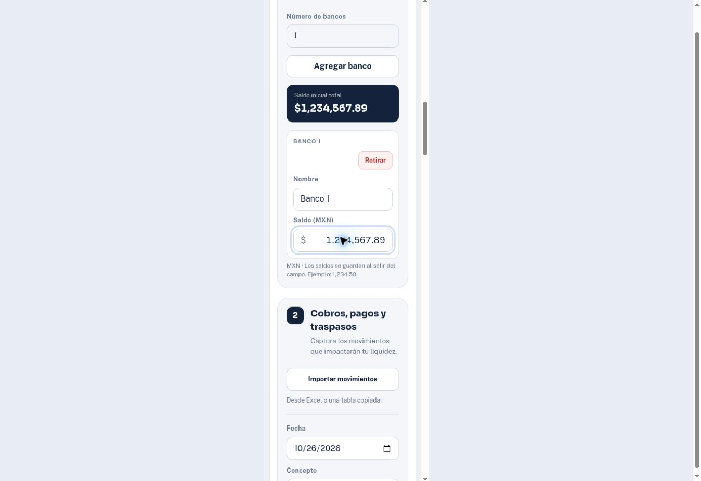

# Verificación: formato contable

Fecha: 26 de octubre de 2026. Base publicada: `81f1a600e020badbac787d0819c01c2f8dc9b086`.

## Resultado y alcance

Se aplicó [la especificación de formato contable](accounting-format-spec.md) a los campos de importe y saldo, y a las superficies monetarias de la aplicación. Se añadió un módulo compartido de presentación y lectura de cantidades; no se migraron datos ni se alteraron importes por el solo hecho de mostrarlos.

Los importes muestran miles, dos decimales, negativos entre paréntesis y cero como guion. Los campos editables separan el símbolo `$` a la izquierda de las cifras alineadas a la derecha. La gráfica conserva abreviaturas para millones. Fechas, porcentajes, conteos y texto original de archivos importados conservan su formato.

## Pruebas automatizadas

| Ejecución | Resultado |
| --- | --- |
| `node tests/movements.test.cjs` | 143/143 aprobadas |
| `node tests/excel-export.test.cjs` | 11/11 aprobadas |
| `node tests/treasury-import.test.cjs` | 25/25 aprobadas |
| `node tests/accounting.test.cjs` | 10/10 aprobadas |
| **Total** | **189 aprobadas; cero fallos, cancelaciones u omisiones** |
| `node --check app.js` | Correcto |
| `node --check accounting.js` | Correcto |
| `node --check excel-export.js` | Correcto |
| `git diff --check` | Limpio |

Los 24 contratos añadidos cubren lectura de cantidades pegadas; signos, cero y centavos; límites y agrupación inválida; conservación de precisión anterior; captura, edición y duplicación; guardado atómico de saldos y reintento; aislamiento de escenarios; eventos de enfoque y salida; e interpretación independiente y reimportación del XLSX.

### Invariantes comprobadas

- Enfocar y escribir no reescribe el texto ni guarda cada pulsación. El formato se aplica al salir del campo.
- Un saldo vacío, negativo, con milésimas o agrupación inválida no sustituye el último saldo guardado por cero. Si falla el almacenamiento, se conserva el borrador y se puede reintentar.
- Enter mantiene la captura. El registro y el reset del formulario ocurren después de guardar mediante el botón explícito.
- Editar solo concepto, fecha o estatus no redondea un importe anterior sin cambios, incluso si contiene precisión heredada.
- Los saldos solo se guardan en el banco y escenario de origen. Un contexto obsoleto no escribe en otro escenario.
- Los pagos se siguen almacenando y exportando como magnitudes positivas con su tipo separado. Las filas los muestran entre paréntesis sin duplicar signos.
- El exportador conserva celdas numéricas, centavos y tipos. Su formato contable tiene secciones de positivo, negativo, cero y texto; un lector independiente interpreta las cuatro y el archivo se reimporta sin cambiar los valores.

## Verificación en Chrome

Se usaron datos ficticios en la previsualización administrada. Las operaciones se realizaron con los controles de la página, sin modificar el estado interno ni `localStorage` desde automatización.

| Flujo | Evidencia observada |
| --- | --- |
| Saldo pegado | `MXN $ 1,234,567.89` no cambió el total mientras se escribía. Al salir, el campo mostró `1,234,567.89` y el total `$1,234,567.89`. |
| Saldo inválido | `1,23` quedó visible con error; el total siguió siendo `$1,234,567.89`. Corregirlo permitió guardar. |
| Captura y Enter | `$1,234.50` y el concepto se conservaron al pulsar Enter. Al salir del campo apareció `1,234.50`; Agregar movimiento registró un pago mostrado como `($1,234.50)`. |
| Edición individual | Cambiar solo el concepto conservó `($1,234.50)`. El modal abrió el importe como `1,234.50`. |
| Duplicación | La copia aceptó `98765.43`, lo presentó como `98,765.43` y se guardó por `($98,765.43)`. El original siguió por `($1,234.50)`. |
| Recarga | Volver a la proyección personal restauró el saldo de `$1,234,567.89` y los dos movimientos con sus centavos. |
| Escritorio | Saldo e importe muestran el símbolo separado y las cifras alineadas a la derecha. Los pagos del detalle usan paréntesis. |
| Vista compacta de 390 px | Ancho útil y ancho de desplazamiento de la página: 375 px; sin desbordamiento horizontal. |
| Vista compacta de 320 px | Ancho útil y de desplazamiento de la página: 305 px. El saldo de `1,234,567.89` cabe en el campo sin desplazamiento interno. |
| Modal a 320 px | Diálogo de 267 px entre las posiciones 19 y 286 de un ancho útil de 305 px. El importe `98,765.43` cabe íntegro. |

### Corrección encontrada durante la prueba nativa

La primera versión quitaba separadores al enfocar el campo. Una operación nativa de selección y pegado podía intercalarse con ese cambio de valor y concatenar texto. Se eliminó la reescritura al enfocar; solo se limpia la validación previa. Se repitió el pegado con moneda y miles, y se añadieron contratos que exigen conservar exactamente el texto en el enfoque.

## Evidencia visual

Las capturas muestran datos ficticios del entorno de prueba.

## Límites de la verificación

- Los contratos de aplicación usan un adaptador DOM; las interacciones nativas indicadas arriba se comprobaron en Chrome.
- Los anchos compactos se comprobaron mediante un iframe de ancho controlado; no son una prueba en teléfono físico ni de zoom nativo.
- La validación del XLSX usa lectura independiente y reimportación; no se verificó su disposición visual en Excel de escritorio.
- No se ejecutó una matriz adicional de Safari, Firefox o lectores de pantalla. El incremento no cambia la persistencia local ni incorpora sincronización entre dispositivos.
