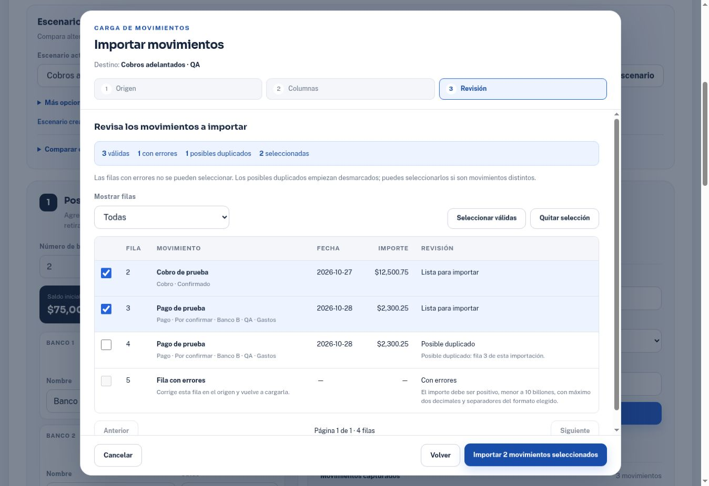
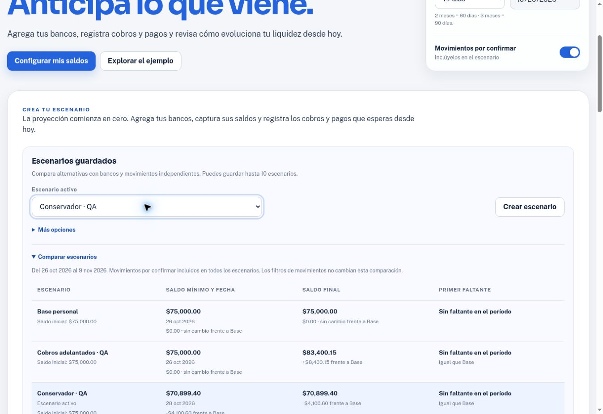

# Verificación: importación, duplicación y escenarios guardados

Fecha: 26 de octubre de 2026. Base remota: `6ce924321cbf0a4d2195a00671dd95d997723823`.

## Alcance y resultado

Se integraron las tres funciones solicitadas, siguiendo [la especificación del incremento](import-duplicate-scenarios-spec.md). Las comprobaciones usan datos ficticios. La información de las simulaciones y las importaciones sigue guardándose solo en el navegador.

La revisión conservó las 95 pruebas anteriores de la aplicación y las 9 del exportador. Se añadieron 36 contratos de aplicación/controladores y 25 pruebas del lector de archivos. El cierre de las tres suites produjo **165 aprobadas, cero fallos, cero omitidas**.

## Comprobaciones automatizadas

| Ejecución | Resultado |
| --- | --- |
| `node tests/movements.test.cjs` | 131/131 |
| `node tests/excel-export.test.cjs` | 9/9 |
| `node tests/treasury-import.test.cjs` | 25/25 |
| Sintaxis de `app.js`, importador y Worker | Correcta |
| `git diff --check` | Limpio |
| IDs, destinos `for`/ARIA y selectores estáticos | Sin duplicados ni destinos ausentes |
| Pruebas de fecha del importador en Pacific/Honolulu y Asia/Tokyo | 3/3 en cada zona |

### Contratos cubiertos

- Importación anexada en una escritura, solo de filas seleccionadas, con IDs nuevos y validación final independiente del reporte de revisión.
- Fallo de almacenamiento, fila inválida seleccionada y contexto obsoleto: no hay importaciones parciales ni pérdida del borrador.
- Selección inicial de válidas sin duplicados, selección explícita de coincidencias y permiso explícito para históricos.
- Cancelación de una lectura que termina tarde: no altera una importación nueva ni inserta en otro escenario.
- Duplicación con ID nuevo, original intacto, campos aplicables al tipo, fecha válida y destino de origen.
- Copias independientes de cuentas y movimientos, nombres/límites, persistencia/recarga y compatibilidad con el almacenamiento anterior.
- Comparación con horizonte y pendientes comunes, sin depender de filtros de tabla.
- Aplicación de una simulación a Base con copia previa en una única escritura; un error conserva todo.
- Deshacer ligado al escenario de origen y a su plazo de cinco segundos. Vaciar/eliminar/renombrar respetan el destino elegido.
- Lectura de nuestro XLSX exportado y libros comprimidos independientes de XlsxWriter y SheetJS; varias hojas, fechas 1900/1904, centavos, fórmulas con valor guardado y fórmulas sin caché.
- Texto CSV/TSV con comillas y saltos de línea, referencias ambiguas/desconocidas, datos inválidos y posibles duplicados.
- Límites de ZIP/expansión real, CRC, archivos truncados, cancelación y timeout del Worker.

### Defectos encontrados y corregidos durante la revisión

1. Algunos XLSX normales de SheetJS declaran tipos relacionados con macros que no utilizan. La detección se ajustó para revisar las partes realmente presentes; se añadió una regresión con ese escritor.
2. La validación antigua rechazaba algunos importes grandes con centavos correctos por representación binaria, aunque el importador los reconocía. Se unificó el criterio numérico con una tolerancia acotada. Una prueba recorre revisión real → confirmación → almacenamiento con `268435456.03`, `536870912.05` y `10000000000.03`, y confirma que las milésimas siguen rechazadas.
3. Las transiciones de importación ahora enfocan el primer control del nuevo paso. La región de revisión tiene nombre accesible y un punto de foco para desplazarse con teclado, incluso si todas las filas tienen errores.

## Verificación en Chrome

Entorno de prueba servido por la previsualización administrada. Se comprobaron las acciones reales mediante controles de la página; no se modificó el estado interno ni `localStorage` con código de automatización.

| Flujo | Evidencia observada |
| --- | --- |
| Carga de datos anteriores | Base conservó 2 bancos y 3 movimientos históricos de la prueba previa. |
| Crear simulación | `Cobros adelantados · QA` recibió una copia independiente de Base. |
| Pegar tabla | 4 filas: 3 válidas, 1 inválida, 1 posible duplicado; 2 seleccionadas inicialmente. Solo las 2 seleccionadas se guardaron. |
| Importación y Base | Simulación: saldo final `$85,200.50`; Base permaneció en `$75,000.00` y conservó sus 3 movimientos. |
| Duplicación | Abrir/cancelar una copia histórica no añadió registros; su fecha antigua impidió guardar. Duplicar un pago futuro permitió cambiar concepto e importe a `$1,800.35`, conservando el original de `$2,300.25`. |
| Enter y captura pendiente | Enter conservó concepto e importe. Al intentar cambiar de escenario apareció la confirmación; cancelarla conservó la captura y el escenario. |
| XLSX comprimido real | Se cargó `tests/fixtures/import-normal.xlsx` mediante el selector de archivos. El Worker reconoció sus 3 hojas y columnas. |
| Fórmulas y errores | Revisión de la primera hoja: 4 válidas y 1 error de Excel; el importe calculado conservó `$1,234.50` con aviso. El texto que comienza con `=HYPERLINK` se mostró como texto. |
| Elegir hoja e importar | La hoja Traspasos añadió un solo registro de `$1,250.75`; la salida/entrada bancaria coincidió y el saldo consolidado no cambió por el traspaso. |
| Duplicar/renombrar escenario | Se creó `Conservador · QA` a partir de la simulación y se desplazó su cobro al 30 de noviembre. El escenario original conservó el cobro del 27 de octubre. |
| Recarga | La página abrió en ejemplo; al volver a la proyección personal restauró `Conservador · QA` y sus 7 movimientos. |
| Comparación | A 14 días: Base `$75,000.00`, simulación `$83,400.15`, conservador `$70,899.40`. Al elegir 90 días y excluir pendientes, ambas simulaciones reflejaron `$87,500.75` bajo la misma regla. |
| Usar como Base | El modal mostró 3 movimientos de Base frente a 7 de la simulación. Confirmar activó Base con los 7 y añadió `Base anterior · 2026-10-26`, conservando la simulación original. |
| Vista compacta | Se revisaron contenedores de 320, 390, 680 y 768 px. Sin desbordamiento horizontal de la página; comparación y revisión usan tarjetas en el rango compacto. |
| Diálogos en teléfono | Importación a 390 px y duplicación a 320 px permanecieron dentro del ancho disponible. La importación mantuvo destino, selección y acciones visibles con desplazamiento interno. |
| Teclado | Revisión recibió foco en Mostrar filas. Escape cerró la importación y devolvió foco a Importar movimientos. |

Las medidas útiles del documento excluyen la barra de desplazamiento de Chrome: 305, 375, 665 y 753 px, respectivamente. La comprobación corresponde a esos anchos de contenedor en un iframe; no se presenta como prueba en un teléfono físico ni como prueba del zoom nativo del navegador.

## Capturas

Las imágenes muestran datos ficticios de la prueba, no información financiera real.

## Límites de esta verificación

- Los contratos automatizados de aplicación usan un adaptador DOM; Chrome cubre los flujos indicados arriba. Eliminar/vaciar escenarios y los fallos de almacenamiento se verificaron en contratos, sin simular cuota agotada en Chrome real.
- No se ejecutó una matriz de Safari/Firefox ni lectores de pantalla. La disponibilidad de Worker y descompresión nativa se comprueba con errores explícitos; pegar una tabla sigue siendo una alternativa.
- Los archivos admitidos son `.xlsx`, CSV y TSV UTF-8, con los límites publicados. No se afirma compatibilidad con `.xls`, archivos con macros, cifrados ni con todos los productores posibles de Excel.
- Los escenarios y la copia automática de Base viven en el mismo navegador. No son respaldo externo, cuentas multiusuario ni sincronización.
- Los errores de la extensión del navegador de prueba se distinguieron de los errores de la aplicación; no se observó un error de ejecución de la aplicación en los flujos revisados.
