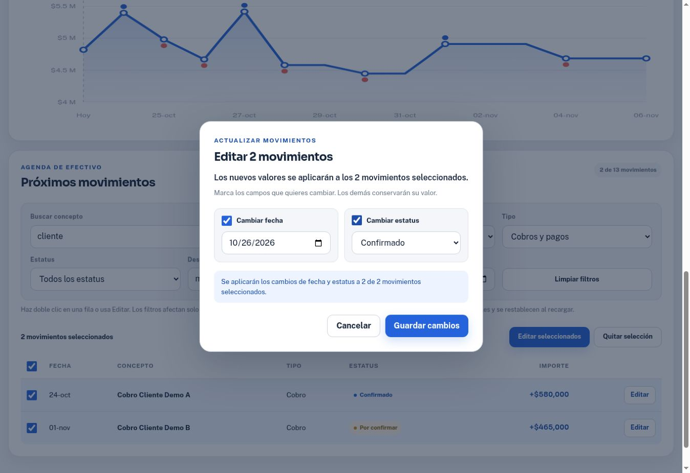

# Evidencia de selección y edición de movimientos

Fecha: 23 de octubre de 2026. Base inspeccionada: `4211a938a89c0ed69dc81c56950583dd86bed7dc`.

## Resultado de comprobaciones

**VERIFICADO** — `node --check app.js`: código de salida 0.

**VERIFICADO** — `node tests/movements.test.cjs` con Node v24.19.0: 42 pruebas, 42 PASS, 0 FAIL, 0 omitidas. Utiliza `node:test`, `node:vm`, almacenamiento y DOM sintéticos; no sustituye las comprobaciones de navegador.

**VERIFICADO** — `git diff --check`: código de salida 0. Verificación adicional mediante `lxml`: sin IDs HTML duplicados; todas las etiquetas, referencias ARIA y consultas de elementos de `app.js` resuelven.

**VERIFICADO** — integración en Chrome mediante la vista interna del proyecto, usando exclusivamente datos de ejemplo y dos movimientos de prueba. No se importaron archivos ni datos financieros personales.

## Trazabilidad

| Requisito | Implementación | Evidencia |
| --- | --- | --- |
| R1 Selección | `updateMovementSelection`, handlers de casillas, barra de selección | Node: ninguna/parcial/todas, IDs visibles, contador. Chrome: marcar una fila produce 1 seleccionado; seleccionar los dos resultados filtrados abre Editar 2 movimientos. |
| R2 Filtros | `getVisibleMovements`, controles de búsqueda/tipo/estatus/fechas/alcance | Node: combinación, límites inclusivos, rango invertido y separación de KPIs. Chrome: buscar cliente reduce a 2 de 13; saldo proyectado conserva $4,685,000; nueva búsqueda limpia selección. |
| R3 Individual | `openMovementEditor`, doble clic y botones Editar | Chrome: doble clic en Cobro Cliente Demo A abre sus valores actuales; botón de la lista de captura abre el mismo editor. Node: doble clic en checkbox no abre editor. |
| R4 Lote | `prepareMovementEdit`, controles para activar campos | Chrome: cambiar solo estatus en 2 filas modifica 1 que estaba pendiente y conserva ambas fechas. Segundo lote: 2 pagos de prueba cambian a 26/oct/2026 y Confirmado; importes $1,234 y $2,345 se conservan. |
| R5 Validación | `isValidISODate`, validación del parche y selección | Node: fechas imposibles/pasadas, bisiestos, IDs ausentes/duplicados y campos no autorizados. Chrome: fecha 22/oct/2026 es rechazada; Guardar deshabilitado. |
| R6 Persistencia/cálculo | `persistCustomCandidate`, `commitMovementEdit`, renderizado de vistas dependientes | Node: escritura única, fallo sin mutación, recarga y límites de horizonte. Chrome: mover cobro demo de $580,000 a 1/dic/2026 reduce saldo de $4,685,000 a $4,105,000; alcance Todos lo recupera. Los 2 pagos de prueba conservan fecha/estatus al recargar y volver a proyección personal. |
| R7 Cancelación/foco | `<dialog>`, `finishMovementEditor`, cancelación nativa | Chrome: Escape cierra sin modificar fila; después de guardar desde captura, el foco regresa al botón Editar del movimiento en esa lista. Node: Cancel descarta borrador sin escribir. |
| R8 Enter/captura | `handleCaptureKeydown`, guardado de candidato en `addMovement` | Chrome: Enter conserva fecha 24/oct/2026, concepto Pago prueba QA A, tipo Pago, estatus Por confirmar e importe 1234; siguen 0 movimientos. Botón explícito agrega una sola fila. Node: fallos de validación/almacenamiento conservan borrador. |
| R9 Demo separada | `state.demoEdits`, `getActiveMovements` | Chrome: recargar restaura fechas/estatus de demo mientras conserva la proyección personal de prueba. Node: demo no escribe en almacenamiento personal. |

## Revisión y límites

- **VERIFICADO:** revisión independiente del contrato de datos, eventos y referencias HTML. Se corrigió el retorno de foco para no saltar desde captura a la tabla después de guardar.
- **VERIFICADO:** inspección visual de tabla, filtros, selección y modal en escritorio. El modal utiliza controles nativos y ofrece botón Editar además del doble clic.
- **NO VERIFICADO:** prueba física en móvil, Safari/Firefox y lector de pantalla. Los estilos adaptables y controles de teclado fueron revisados; no se presentan como pruebas en esos entornos.
- **NO VERIFICADO:** conflicto de escritura simultánea entre dos pestañas. El modelo preexistente de almacenamiento local no tiene sincronización entre pestañas; esta ampliación conserva esa arquitectura.
- **NO APLICA:** typecheck TypeScript, compilación, migraciones de servidor, autenticación o permisos de backend. No se añadieron dependencias de ejecución.
- **Fuera de alcance observado:** la gestión previa de saldos/bancos y el borrado conservan su mecanismo de almacenamiento; el control de fallo atómico de este cambio cubre la captura y la edición solicitadas.

## Reproducción manual

1. Abrir Ver ejemplo. Buscar cliente, marcar filas y comprobar que los indicadores no varían por el filtro.
2. Abrir Editar seleccionados, activar solo Estatus, elegir Confirmado y guardar. Verificar fechas e importes intactos.
3. Hacer doble clic en una fila. Probar una fecha anterior a hoy; comprobar error. Pulsar Escape y verificar que la fila no cambió.
4. Cambiar una fecha fuera del horizonte. Comprobar el nuevo saldo y recuperar el registro con Mostrar → Todos los movimientos.
5. En Crear mi proyección, llenar una captura y pulsar Enter en un input. Comprobar valores intactos y cero registros nuevos. Registrar con el botón.
6. Editar dos registros en lote, recargar y volver a Crear mi proyección para comprobar persistencia.

Las pruebas no autorizan ni ejecutan pagos reales: se trata de una proyección local de tesorería.
