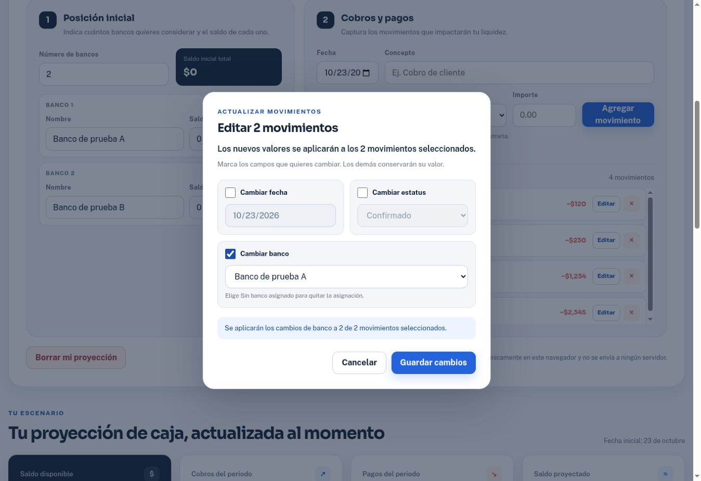

# Verificación: banco opcional en los pagos

Fecha: 23 de octubre de 2026. Base: `0eadd7902898bfabe85d5cbd1824910dc1fc34ba`. Alcance definido en [la especificación](optional-payment-bank-spec.md).

## Resultado

- **VERIFICADO:** `node --check app.js`, código 0.
- **VERIFICADO:** `node tests/movements.test.cjs`, 60 pruebas PASS, 0 FAIL, 0 omitidas. Son las 42 anteriores más 18 de banco opcional (etiqueta R10). El adaptador DOM y el almacenamiento de estas pruebas son sintéticos.
- **VERIFICADO:** `git diff --check`, código 0; análisis HTML con lxml sin IDs duplicados ni referencias de etiquetas/ARIA/consultas ausentes. Ambos selectores bancarios tienen opción vacía y carecen de required.
- **VERIFICADO:** interacción en Chrome sobre la vista interna, con cuentas y pagos ficticios. Captura, edición, persistencia y apariencia comprobadas según la tabla siguiente.
- **VERIFICADO:** revisión independiente del cambio, sin hallazgos bloqueantes. Las funciones de cálculo no cambiaron; las ediciones sucesivas de demo conservan bankId en memoria.

## Requisito → implementación → evidencia

| Requisito | Implementación | Evidencia |
| --- | --- | --- |
| B1 Captura opcional | `renderCaptureBank`, `renderBankOptions`, `addMovement`; `movementBank` sin required | Node: vacío/asignado, cobro con selección residual y banco desconocido. Chrome: Pago QA sin banco se guarda por $120 con Sin banco asignado; el contador pasa de 2 a 3. Otro pago de $230 se guarda con Banco de prueba B. |
| B2 Editar banco | `openMovementEditor`, `getMovementEditPatch`, `prepareMovementEdit`; tarjeta `editBankField` | Node: asignar/cambiar/quitar, no-op vacío, lote de pagos y rechazo de lote mixto. Chrome: elegir vacío en el pago de $230 quita su banco. Seleccionar los dos pagos de prueba y activar solo Cambiar banco asigna Banco de prueba A a ambos; fecha, estatus e importes se conservan. |
| B3 Recarga/legacy | `loadCustomState`, `persistCustomCandidate` | Node: proyección antigua intacta, lectura sin escritura, asignación y referencia huérfana tras recarga. Chrome: recargar y volver a Crear mi proyección conserva los dos pagos nuevos, uno vacío y otro con Banco de prueba B. |
| B4 Identidad/etiquetas | `getMovementBankId`, `getMovementBankLabel`; renderizado de captura/tabla | Node: renombrar por ID, eliminar/recrear banco sin reasignar pagos, limpiar huérfano. Chrome: renombrar Banco de prueba A como Banco de prueba A actualizado actualiza los dos pagos en tabla y captura. |
| B5 Validación/atomicidad | Validación de bankId y tipo de todos los seleccionados antes de `persistCustomCandidate` | Node: cuentas inexistentes/ambiguas, tipos inválidos, cobros en lote y almacenamiento rechazado no producen cambios parciales. El editor permite cambiar estatus de un pago histórico con banco retirado. |
| B6 Invariantes | Parches limitados a los campos elegidos, `handleCaptureKeydown`, overrides de demo | Node: fecha, concepto, tipo, importe, estatus, cuentas y forecast intactos; demo no escribe datos personales. Chrome: Enter conserva concepto Pago QA con banco, importe 230 y Banco de prueba B, sin aumentar los 3 movimientos existentes. Cambiar/quitar/asignar banco conserva el saldo proyectado de −$3,929 después de capturar ambos pagos. |

## Inspección visual y límites

**VERIFICADO:** el selector de captura ocupa el ancho completo del formulario; en la vista de escritorio inspeccionada mide aproximadamente 656 px. El modal muestra el campo de banco bajo fecha/estatus, con ayuda para quitar la asignación. Los nombres y IDs se escapan al renderizar HTML.

**NO VERIFICADO:** dispositivo móvil físico, Safari/Firefox y lector de pantalla. La revisión de las reglas de una, dos y cuatro columnas no se presenta como una prueba en esos dispositivos.

**NO APLICA:** migración de base de datos, typecheck TypeScript o compilación de aplicación; sigue siendo HTML/CSS/JavaScript estático sin dependencias adicionales. La gestión previa de saldos/bancos y borrado queda fuera de esta ampliación.

## Reproducción breve

1. En Crear mi proyección, elegir Pago y completar fecha, concepto e importe. Dejar Sin banco asignado y guardar.
2. Capturar otro pago con un banco registrado. Pulsar Enter en Concepto: comprobar que el banco y el resto del borrador se conservan; guardarlo mediante el botón.
3. Recargar, volver a la proyección personal y comprobar ambas asignaciones.
4. Editar el pago asignado, elegir Sin banco asignado y guardar. Seleccionar ambos pagos, activar solo Cambiar banco y asignar uno en lote.
5. Renombrar ese banco; comprobar el nuevo nombre en los pagos y los mismos importes/totales.
