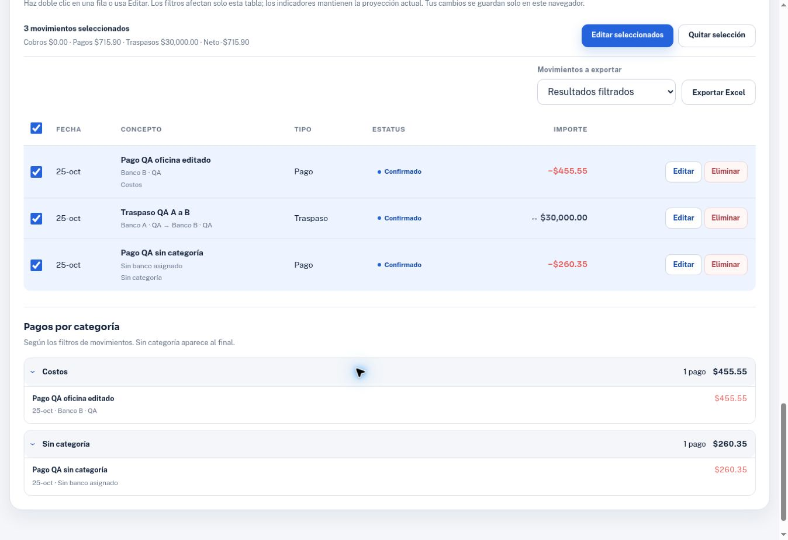
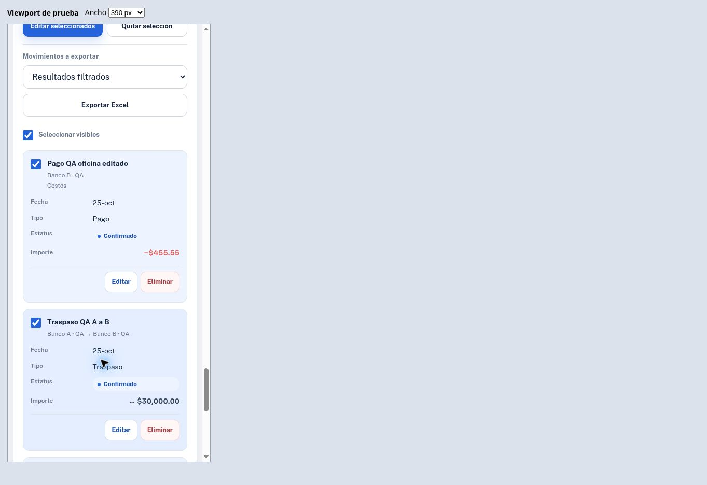

# Evidencia de la ampliación de tesorería

Fecha: 25 de octubre de 2026. Base publicada: `317cf73d8d57057e66b2f42fa2270cf46bb6526e`.

Alcance y reglas: [especificación de la ampliación](treasury-expansion-spec.md). Las pruebas de navegador usaron únicamente datos ficticios identificados como QA en un preview local; no se cargaron datos financieros del usuario al repositorio.

## Resultado de los controles

| Control | Estado | Evidencia y límites |
| --- | --- | --- |
| Contratos de la aplicación | VERIFIED | `node --test-reporter=tap tests/movements.test.cjs`: 95 pruebas, 95 aprobadas, 0 fallos, 0 omitidas. Se conservan las 60 comprobaciones previas y se añaden 35. |
| Escritor Excel | VERIFIED | `node --test-reporter=tap tests/excel-export.test.cjs`: 9 pruebas, 9 aprobadas, 0 fallos. ZIP/CRC, estructura OOXML, XML escapado, fechas/importes tipados y conceptos similares a fórmulas como texto. |
| Lectura independiente del Excel | VERIFIED | Revisión delegada con `openpyxl`, `zipfile` y `ElementTree`: fechas, 0.01 y 999999.99, acentos/emoji, texto de fórmula, filtro y primera fila inmovilizada. No se reutiliza el escritor para leer el resultado. |
| Sintaxis | VERIFIED | `node --check app.js` y `node --check excel-export.js`. |
| Estructura HTML | VERIFIED | IDs únicos; referencias de labels/ARIA y selectores DOM de la aplicación existentes; exportador cargado antes de `app.js`. |
| Revisión del diff | VERIFIED | `git diff --check` sin errores. Revisión independiente de neutralidad de traspasos, edición parcial, retiro y recuperación. |
| Navegador | VERIFIED con alcance | Chrome, captura/corrección/selección/filtros/diálogos/recarga y medidas de layout descritas abajo. |
| Descarga recibida por Chrome | VERIFIED | Desde el sitio HTTPS publicado se descargó un XLSX de 13 movimientos seleccionados y se abrió con un lector independiente: 13 filas, 10 columnas, importes numéricos, fechas, IDs únicos, filtro A1:J14 y primera fila inmovilizada. El intento anterior en el preview HTTP no devolvió archivo; la comprobación válida de recepción corresponde al sitio público. |
| Excel de escritorio | NOT VERIFIED | No se abrió la exportación en una instalación de Microsoft Excel. |
| Dispositivo físico y zoom nativo | NOT VERIFIED | Se comprobó layout real dentro de viewports de ancho controlado. No se emuló un dispositivo físico ni se logró verificar un cambio de zoom nativo de Chrome. |
| Compilación/TypeScript/backend | N/A | Aplicación estática con HTML/CSS/JavaScript; sin build, tipos ni backend. |

## Trazabilidad de aceptación

| Requisito | Implementación principal | Comprobación |
| --- | --- | --- |
| E1 · 2/3 meses | Opciones 60/90 en `index.html`; ayuda visible; filtros y serie existentes | Contratos de inclusión exacta del límite, exclusión del siguiente día y longitud de serie. Selección de 90 días observada en Chrome. |
| E2 · Categorías | Catálogo, `getPaymentGroups`, captura/editor/filtro, `renderPaymentGroups` | Legacy sin categoría, asignación/quitar individual y lote, rechazo de categorías inválidas/selecciones incompatibles. En Chrome: Costos con $455.55 y Sin categoría al final con $260.35. |
| E3 · Centavos | `detailCurrency` y celdas numéricas del Excel | Dos decimales en detalle sin cambiar el redondeo previo de KPIs. Importes de 1250.75, 450.25, 455.55 y 260.35 vistos en captura/edición/listado. |
| E4 · Excel | `getExportRows`, `exportMovementsToExcel`, `excel-export.js` | Escritor y lector independiente aprobados. UI con alcance filtrados/seleccionados/todos y confirmación de exportación observada. Archivo descargado del sitio público y leído: 13 movimientos seleccionados, fechas/importes tipados y ninguna celda de fórmula. |
| E5 · Traspasos | Movimiento único `transfer`, validación de extremos, impacto consolidado cero y neto por banco | Contratos de captura/carga/extremos/selección/forecast/KPIs. Chrome: $30,000 de A a B; iniciales $50,000/$25,000; saldos tras traspasos $20,000/$55,000; efectivo inicial consolidado $75,000. |
| E6 · Retirar banco | Modal de impacto, `getBankRemovalImpact`, `commitBankRemoval` | Contratos de conservación de pagos, último banco, traspasos vinculados y fallo de guardado. Chrome: Banco B muestra $25,000 inicial, 1 traspaso de $30,000 y 1 pago; confirmación deshabilitada por el traspaso. |
| E7 · Vista compacta | Mismo DOM convertido en tarjetas a 680 px o menos; grids flexibles y etiquetas | Sin scroll horizontal de página en viewports 320, 390, 680, 768 y 1600 px; tarjetas en los tres primeros y tabla en los dos últimos. Captura, selección y modal comprobados a 390 px. |
| E8 · Deshacer | Map de tokens, plazo fijo de 5000 ms, persistencia antes de cambios, restauración sobre datos actuales | Caducidad exacta, múltiples borrados, cambios/altas posteriores, IDs duplicados, referencias y errores de almacenamiento. Chrome: eliminación y restauración del pago editado dentro del plazo, mensaje Movimiento restaurado y mismo contenido. |
| E9 · Total seleccionado | `getSelectionTotals` y barra de selección | Contratos de neto y transferencia contada una vez. Chrome: 3 filas, pagos $715.90, traspasos $30,000.00 y neto -$715.90. |
| E10 · Filtro por banco | `movementMatchesBank`, opciones asignado/sin banco/no disponible | Contratos para ambos extremos del traspaso y pagos sin banco. Chrome: Banco B devuelve su pago y el traspaso; limpia la selección anterior. |
| E11 · Concepto/importe individual | Campos del modal, normalización y `prepareMovementEdit` | Validación positiva/hasta 2 decimales, concepto 1–70, rechazo de lote y persistencia atómica. Doble clic abre modal; Chrome guarda concepto editado e importe $455.55, conservados al recargar. |

Los filtros de la tabla, grupos y exportación de resultados usan la misma lista visible. El resumen por banco refleja solo el saldo inicial más traspasos del período; no se anuncia como proyección completa por cuenta.

## Regresión observada en Chrome

- Enter sobre el importe de un pago dejó intactos concepto, importe, banco vacío y categoría vacía; no añadió un registro y mostró la indicación de usar Agregar movimiento.
- Agregar movimiento guardó un pago sin banco ni categoría y reinició la captura únicamente después del alta explícita.
- Doble clic abrió el editor individual; cambiar concepto, importe y categoría actualizó la fila y el grupo correspondiente.
- La selección y el modal funcionaron también dentro del viewport compacto. El modal midió 337 px y permaneció dentro del área útil de 375 px.
- Los datos QA guardados, la categoría, los centavos y las cuentas del traspaso se conservaron tras recargar.

## Medidas de layout

Ancho del viewport de prueba, seguido de ancho útil del documento descontando su barra de scroll. En cada caso `scrollWidth` fue igual a `clientWidth`:

| Viewport | Ancho útil / scrollWidth | Filas de movimientos |
| --- | --- | --- |
| 320 px | 305 / 305 px | Grid de tarjetas |
| 390 px | 375 / 375 px | Grid de tarjetas |
| 680 px | 665 / 665 px | Grid de tarjetas |
| 768 px | 753 / 753 px | Tabla |
| 1600 px | 1585 / 1585 px | Tabla |

La prueba utilizó un documento auxiliar con un iframe de ancho controlado, no publicado en el repositorio. Estas medidas respaldan el comportamiento responsive; la equivalencia con todos los motores móviles o porcentajes de zoom es INFERRED y requiere comprobación en esos entornos.

## Hallazgos corregidos durante la revisión

- Caducar una alerta reconstruía los botones y podía perder el foco de otra recuperación vigente. Ahora se recupera el foco del mismo token cuando sigue disponible.
- Restablecer podía limpiar memoria/tokens antes de que fallara la eliminación en almacenamiento. Ahora elimina del almacenamiento primero; ante fallo conserva datos, selección y recuperaciones y muestra el error.
- Ambos defectos se reprodujeron antes de la corrección; los cinco casos nuevos de foco/restablecimiento pasan después.
- La revisión visual ajustó las filas de impacto de retiro, el botón Eliminar de la tabla y las dos columnas del detalle por categoría.

## Límites conocidos

- Deshacer es temporal: cinco segundos en la sesión actual. No constituye papelera ni respaldo persistente.
- El Excel contiene movimientos, no toda la configuración de bancos/saldos; no es un formato de restauración de la proyección.
- Por precisión de la hoja de cálculo, el escritor rechaza importes de 10^13 o superiores con un error visible. El validador general admite algunos valores extremos mayores; no se ha unificado ese límite en esta entrega.
- El retiro bloquea cualquier traspaso vinculado, aunque quede fuera del horizonte actual. Los pagos sobreviven con su ID de banco anterior y la etiqueta Banco no disponible.

## Evidencia visual

Capturas del preview con datos ficticios:

## Verificación del despliegue público

- Código publicado: commit `80455431cb94d0bc1fabde62c23e6f5ee7a316c1`.
- GitHub Pages: ejecución `40214956501`, estado completed y resultado success para ese mismo commit.
- URL comprobada en Chrome: https://gusvann.github.io/control-tesoreria-demo/#dashboard . Se observaron los horizontes nuevos, filtro por banco/categoría, detalle con centavos, grupos, selección y exportación.
- Se seleccionaron los 13 movimientos de la demo en horizonte de 90 días y se descargó el alcance Seleccionados. El archivo recibido tiene 15,340 bytes; SHA-256 `55de5287239136ed41e89d861d79056f63cf4625d66a36839626fe47eeeca556`.
- Lectura del archivo efectivamente descargado con `openpyxl` y comprobación ZIP: 13 filas (5 cobros y 8 pagos), 10 columnas, fecha inicial 26 de octubre de 2026, importes numéricos, IDs únicos, cero fórmulas, freeze A2 y autofiltro A1:J14.
- Antes de actualizar main se compararon los hashes de los 11 archivos nuevos/modificados y se comprobaron intactos los otros 6 blobs, incluidas las dos capturas históricas. La actualización utilizó el SHA padre esperado y no forzó el historial.

Esta actualización posterior solo incorpora la evidencia del despliegue y descarga; no cambia el código verificado.
